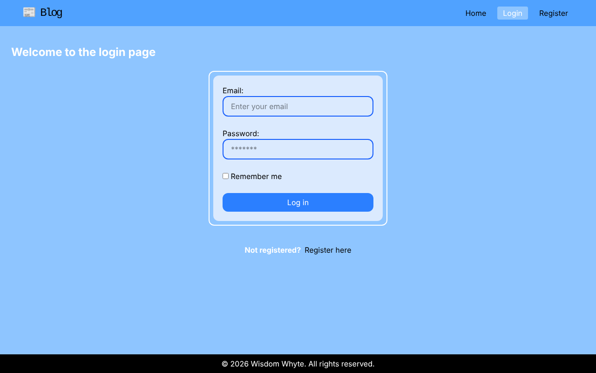
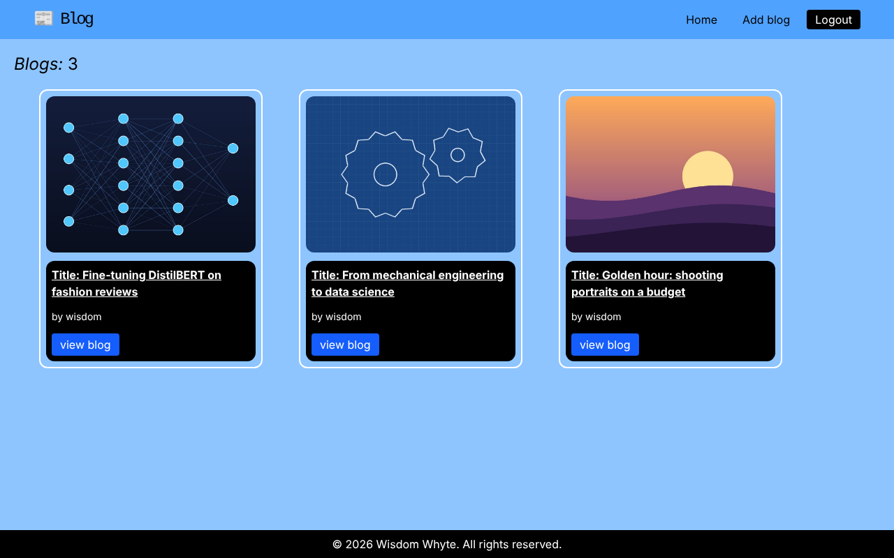
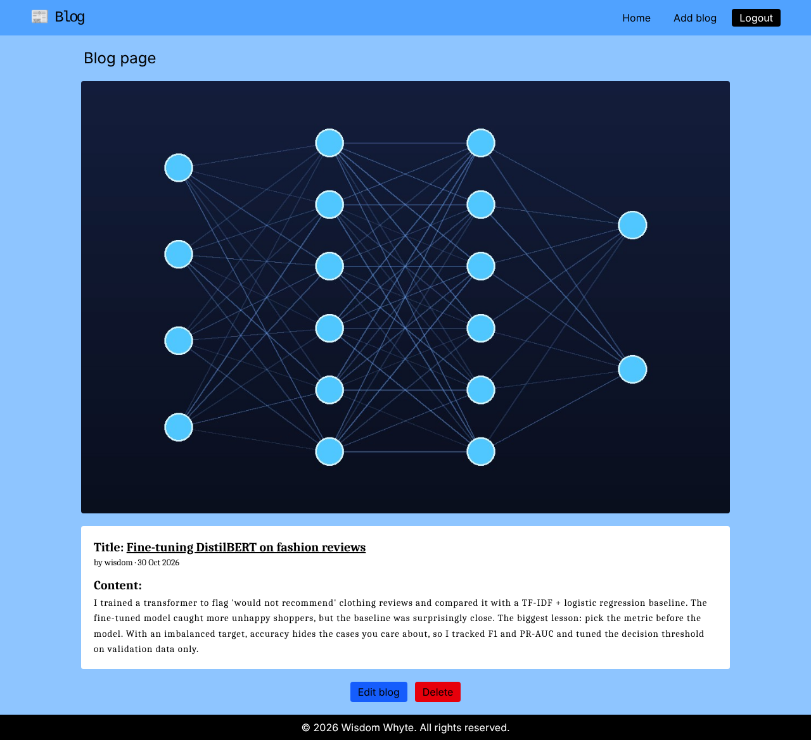

# Flask Blog

A multi-user blogging web app built with Python and Flask. Users register, log in, and write, edit and delete their own posts with an optional cover image.

## Screenshots

| Login | Home feed |
| --- | --- |
|  |  |



*Sample posts and cover images were made for these screenshots.*

## Features

- **Accounts:** registration with validation, login and logout, "remember me" sessions (Flask-Login)
- **Secure passwords:** stored as bcrypt hashes, never in plain text (Flask-Bcrypt)
- **Posts:** create, read, update and delete blog posts, each linked to its author
- **Ownership checks:** only a post's author can edit or delete it; anyone else gets a 403
- **Image uploads:** type-checked, size-limited (5 MB) and saved under unique names so uploads never overwrite each other
- **Database:** SQLite through SQLAlchemy, with a one-to-many relationship between users and posts

## Tech stack

Python · Flask · Flask-SQLAlchemy · SQLite · Flask-Login · Flask-Bcrypt · Jinja2 · Tailwind CSS · Gunicorn

## Data model

| Table | Key fields |
| --- | --- |
| `user` | `id`, `username` (unique), `email` (unique), `password` (bcrypt hash) |
| `blogs` | `_id`, `title` (unique), `content`, `image`, `created_at`, `user_id` → `user.id` |

## Run it locally

```bash
git clone https://github.com/Truthwhyte/flask-blog.git
cd flask-blog
python -m venv venv
source venv/bin/activate        # Windows: venv\Scripts\activate
pip install -r requirements.txt

export SECRET_KEY="any-long-random-string"   # Windows PowerShell: $env:SECRET_KEY="..."
python app.py
```

Then open http://127.0.0.1:5000, register an account and add your first post. Set `FLASK_DEBUG=1` to turn on debug mode while developing.

## Deploy

The `Procfile` runs the app with Gunicorn (`web: gunicorn app:app`), so it can be deployed to platforms such as Render or Heroku. Set `SECRET_KEY` (and optionally `DATABASE_URL`) as environment variables on the host.

## What I'd add next

- CSRF protection on forms (Flask-WTF)
- Pagination and search on the home page
- Tests with pytest and Flask's test client
- Moving uploads to cloud storage for deployment
